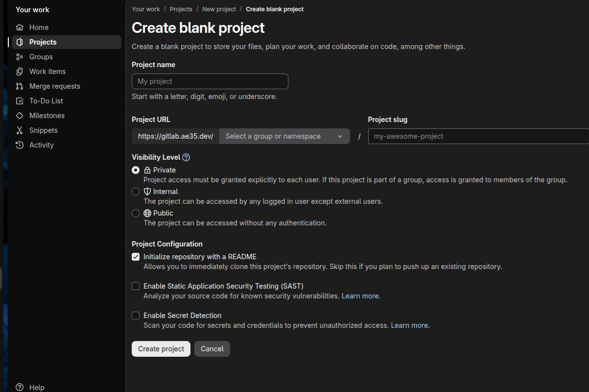
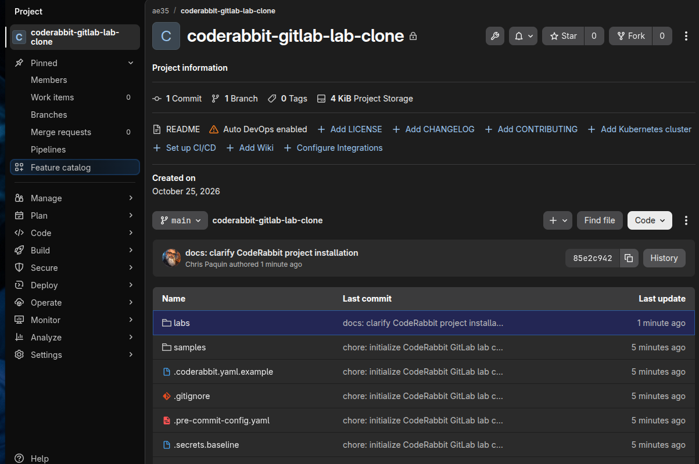
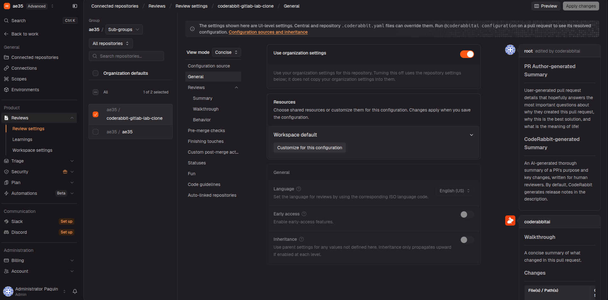
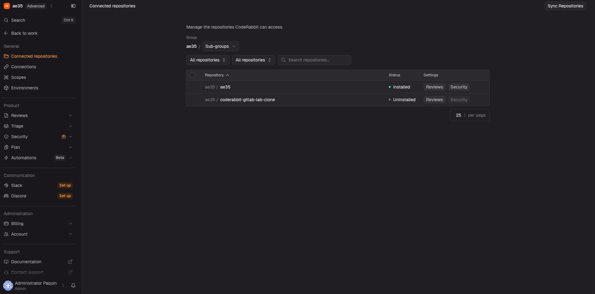

# Lab 0 — Create your GitLab working project and test CodeRabbit

[← Lab index](README.md) · [Main README](../README.md) · Next: [Lab 1](lab-01-planted-bugs.md)

## 0.1 Intention

This lab creates the working copy that you will use for every later experiment.

The GitHub repository named Coderabbit_Gitlab_Lab is the canonical lab template. You should not open the lab MRs in that GitHub repository. Instead, you will create a separate GitLab project named coderabbit-gitlab-lab-clone, install CodeRabbit on that GitLab project, clone it locally, and run the smoke test there.

The result should look like this:

~~~text
GitHub: Coderabbit_Gitlab_Lab
        |
        | import or copy once
        v
GitLab: coderabbit-gitlab-lab-clone
        |
        | clone
        v
Local directory: coderabbit-gitlab-lab-clone
~~~

## 0.2 Choose your GitLab hosting path

Use one of these paths:

- GitLab.com: create or import a new GitLab.com project.
- Public self-managed GitLab: create a new project on your public GitLab server.
- Private self-managed GitLab: create a new project on your private GitLab server and provide CodeRabbit a supported public HTTPS path through a tunnel, reverse proxy, load balancer, or connector.

The author used a private self-managed GitLab with a Cloudflare Tunnel. That is only one solution. CodeRabbit must be able to reach the GitLab web and API endpoint for the working project.

## 0.3 Create the GitLab project

Create an empty project named coderabbit-gitlab-lab-clone in GitLab:

1. Sign in to your GitLab server.
2. Select **New project** or **Create new project**.
3. Choose **Import project** if you are copying from GitHub.
4. Choose **Repository by URL** or the GitHub import option available in your GitLab version.
5. Enter the URL of the canonical GitHub repository: https://github.com/christopherpaquin/Coderabbit_Gitlab_Lab
6. Set the new GitLab project name to coderabbit-gitlab-lab-clone.
7. Keep the project private unless you intentionally want a public exercise.
8. Do not initialize a second README if the import already copies the repository.
9. Select **Create project** or **Import project**.
10. Open the new project and confirm that README.md, samples, and labs are present.

If your GitLab cannot import the GitHub repository directly, create an empty project with the same name and use the fallback in section 0.4.

> Screenshot 0.1 — GitLab **Create blank project** form showing the project name, namespace, visibility, and README initialization options.

This screenshot shows the blank-project path. If you are importing the GitHub template directly, the fields are similar but GitLab will show the repository-import options instead. For this lab, the resulting project must be named coderabbit-gitlab-lab-clone.

> Screenshot 0.2 — The new GitLab project showing the imported README, labs directory, and samples directory.

This confirms that the GitLab working project exists separately from the GitHub template and contains the lab files before CodeRabbit is connected.

## 0.4 Fallback: copy the GitHub template with Git

Use this only if GitLab's import screen cannot copy the repository.

Clone the canonical GitHub template into a temporary directory. This command downloads the GitHub repository and names the local directory Coderabbit_Gitlab_Lab-template so it cannot be confused with your working clone:

~~~bash
git clone https://github.com/christopherpaquin/Coderabbit_Gitlab_Lab.git Coderabbit_Gitlab_Lab-template
~~~

Change into the temporary template directory. The cd command changes only your current shell location:

~~~bash
cd Coderabbit_Gitlab_Lab-template
~~~

Replace the template's origin URL with the new GitLab project's URL. This changes where this temporary clone pushes; it does not change the GitHub repository:

~~~bash
git remote set-url origin <your-gitlab-project-url>
~~~

Verify that origin now points to GitLab. The command prints the fetch and push URLs:

~~~bash
git remote -v
~~~

Push the template's main branch to the empty GitLab project. The -u option records GitLab as the upstream for future pushes:

~~~bash
git push -u origin main
~~~

## 0.5 Install CodeRabbit on the working project

This is the step that connects CodeRabbit to the GitLab project. You are not installing CodeRabbit into the GitHub template, and you are not installing it into the local directory. You are authorizing CodeRabbit to review the GitLab project named coderabbit-gitlab-lab-clone.

Use the path that matches your GitLab hosting.

### GitLab.com

1. Open https://app.coderabbit.ai in your browser.
2. Select **Log in with GitLab** or the GitLab connection offered on the sign-in page.
3. Sign in to the GitLab.com account that owns or can administer coderabbit-gitlab-lab-clone.
4. Approve the requested GitLab authorization.
5. In CodeRabbit, open the repository or organization installation screen.
6. Find coderabbit-gitlab-lab-clone in the GitLab project list.
7. Select **Install**, **Connect**, or the equivalent button shown by your account.
8. Confirm that the project is enabled for reviews.

### Self-managed GitLab

CodeRabbit's current self-managed onboarding starts from the CodeRabbit login page and asks for the public HTTPS URL of the GitLab instance.

1. Open https://app.coderabbit.ai.
2. Select **Self-Hosted GitLab**.
3. Enter the public HTTPS URL of the GitLab web application. For the author's setup this is https://gitlab.ae35.dev. Do not enter the LAN-only SSH hostname gitlab.lab here.
4. Select **Continue**.
5. Choose **Automated onboarding** if you have GitLab instance-admin access and want CodeRabbit to create/configure its bot user and integration.
6. Choose **Manual onboarding** if you do not want to give CodeRabbit an administrator token or need to configure the integration yourself.

For automated onboarding, follow the form to provide the one-time GitLab administrator access token requested by CodeRabbit. This token configures the self-managed instance; it does not automatically mean every project is enabled. After onboarding, install CodeRabbit on coderabbit-gitlab-lab-clone through the repository-installation screen.

For manual onboarding, the current CodeRabbit documentation requires a dedicated CodeRabbit GitLab user, that user's access token, and a GitLab OAuth application. The recommended OAuth scopes are api, read_user, and email/openid as shown by the current CodeRabbit form; the callback URL is https://app.coderabbit.ai/login. Do not put any token or client secret in this repository or in a screenshot.

After the onboarding form succeeds, CodeRabbit may show the project as connected but uninstalled. Connected means CodeRabbit can see the project; installed means review automation is enabled for it.

1. In CodeRabbit, select **Connected repositories** in the left navigation.
2. Find coderabbit-gitlab-lab-clone in the repository table.
3. Select the checkbox beside coderabbit-gitlab-lab-clone.
4. Select **Sync Repositories** in the upper-right corner.
5. Wait for the repository status to change from **Uninstalled** to **Installed**.
6. Select **Reviews** on the installed repository to confirm that review settings are available.
7. Return to the GitLab project and open **Settings > Webhooks**, or the integration page used by your GitLab version.
8. Confirm that a CodeRabbit webhook exists or that the CodeRabbit integration reports the project as installed.
9. If the project is private, test https://gitlab.ae35.dev from a network outside your LAN.

For a self-managed installation, CodeRabbit must be able to reach the GitLab web/API endpoint over HTTPS. Your local Git remote can still use gitlab.lab over SSH; those are separate connections:

~~~text
Git commands:       workstation --SSH--> gitlab.lab
CodeRabbit review:  CodeRabbit --HTTPS--> https://gitlab.ae35.dev
~~~

Do not use the GitHub URL as the CodeRabbit project URL. CodeRabbit must be connected to the GitLab working project.

> Screenshot 0.3 — CodeRabbit login page showing the GitLab or Self-Hosted GitLab choice.

> Screenshot 0.4 — CodeRabbit Review settings for the connected coderabbit-gitlab-lab-clone project.

This screen confirms that coderabbit-gitlab-lab-clone is already connected. The breadcrumb begins with **Connected repositories**, and the project is selected in the repository list. To add another project, select **Connected repositories** in the left navigation, then use the add or install control shown there. Do not look for the add-repository control inside Review settings; this page configures a repository after it has been connected.

> Screenshot 0.5 — CodeRabbit Connected repositories showing coderabbit-gitlab-lab-clone as Uninstalled before synchronization.

This is not the completed state. Select the repository checkbox and choose **Sync Repositories**. Lab 0 is complete only after the status reads **Installed**.

> Screenshot 0.6 — GitLab project settings or webhook page showing the CodeRabbit connection.

## 0.6 Clone the working project locally

Open a terminal in the parent directory where you keep repositories. Clone the GitLab project into a local directory with the same differentiating name:

~~~bash
git clone <your-gitlab-project-url> coderabbit-gitlab-lab-clone
~~~

This downloads the learner-owned GitLab project and creates the local directory coderabbit-gitlab-lab-clone. Replace the placeholder with the clone URL shown by GitLab.

Enter the new working directory. All later lab commands assume you are here:

~~~bash
cd coderabbit-gitlab-lab-clone
~~~

Show the current branch and working-tree state. A clean main branch should show no changed files:

~~~bash
git status --short --branch
~~~

Show the remote URLs. Both fetch and push URLs should point to GitLab and should identify coderabbit-gitlab-lab-clone, not Coderabbit_Gitlab_Lab on GitHub:

~~~bash
git remote -v
~~~

Update the local main branch from GitLab. The pull command downloads remote commits and --ff-only allows the update only when Git can move forward without creating an automatic merge commit:

~~~bash
git switch main
git pull --ff-only
~~~

Expected result: the prompt is inside coderabbit-gitlab-lab-clone, the branch is main, the working tree is clean, and origin points to GitLab.

> Screenshot 0.7 — Terminal showing the local directory, main branch, clean status, and GitLab remote.

## 0.7 Create the smoke-test branch

Create a temporary branch. A branch is an isolated line of work; this keeps the smoke-test edit out of main:

~~~bash
git switch -c lab0-smoke
~~~

Append one harmless line to README.md. The printf command writes only to your local working copy:

~~~bash
printf '\nSmoke-test change for CodeRabbit.\n' >> README.md
~~~

Review the local change before committing. The diff command shows exactly what will be included:

~~~bash
git diff -- README.md
~~~

Stage the README change. Staging tells Git which local changes belong in the next commit:

~~~bash
git add README.md
~~~

Create a local commit. The commit records the smoke-test change in your branch:

~~~bash
git commit -m "test: verify CodeRabbit integration"
~~~

Push the branch to your GitLab project. The -u option records origin/lab0-smoke as the upstream branch:

~~~bash
git push -u origin lab0-smoke
~~~

## 0.8 Open the merge request

1. Open the GitLab project coderabbit-gitlab-lab-clone.
2. Select **Code > Merge requests** in the left navigation.
3. Select **New merge request**.
4. Set **Source branch** to lab0-smoke.
5. Set **Target branch** to main.
6. Select **Compare branches and continue**.
7. Confirm that the diff contains only the harmless README line.
8. Enter the title: **test: verify CodeRabbit integration**.
9. Add this description: **Smoke test to verify GitLab, webhooks, permissions, and CodeRabbit connectivity.**
10. Select **Create merge request**.
11. Do not merge it yet.

In GitHub language, this is opening a PR from lab0-smoke into main.

> Screenshot 0.8 — GitLab MR creation screen showing the project, source branch, target branch, title, and description.

## 0.9 Verify CodeRabbit

Wait a few minutes, then inspect the MR:

1. Open the MR's **Overview** tab.
2. Look for a comment from CodeRabbit.
3. Open **Settings > Webhooks** for the project in another tab, if your onboarding uses project webhooks.
4. Check the recent delivery for the MR event.
5. Record the time from the push to the first CodeRabbit response.

> Screenshot 0.9 — GitLab MR overview showing the source branch, target branch, and title.

> Screenshot 0.10 — CodeRabbit's first response on the smoke-test MR.

> Screenshot 0.11 — GitLab webhook delivery showing the event succeeded, if applicable.

## 0.10 Interpret the result

- If the MR exists but no webhook delivery appears, investigate GitLab integration setup.
- If delivery appears but CodeRabbit does not comment, investigate CodeRabbit access, endpoint reachability, and plan/workspace configuration.
- If a walkthrough appears, the basic plumbing works. That does not prove that every CodeRabbit capability is enabled.

Record:

- GitLab hosting type;
- GitLab version, if self-managed;
- working project URL;
- CodeRabbit workspace or plan;
- branch name and MR number;
- push time;
- first review time; and
- any error message.

## 0.11 Cleanup

Close the MR without merging. Delete the remote smoke-test branch. The first command returns you to main; the second deletes the local branch; the third deletes the branch from GitLab:

~~~bash
git switch main
git branch -D lab0-smoke
git push origin --delete lab0-smoke
~~~

Do not delete coderabbit-gitlab-lab-clone. That is your working project for Labs 1–10.

[← Lab index](README.md) · [Main README](../README.md) · Next: [Lab 1](lab-01-planted-bugs.md)
